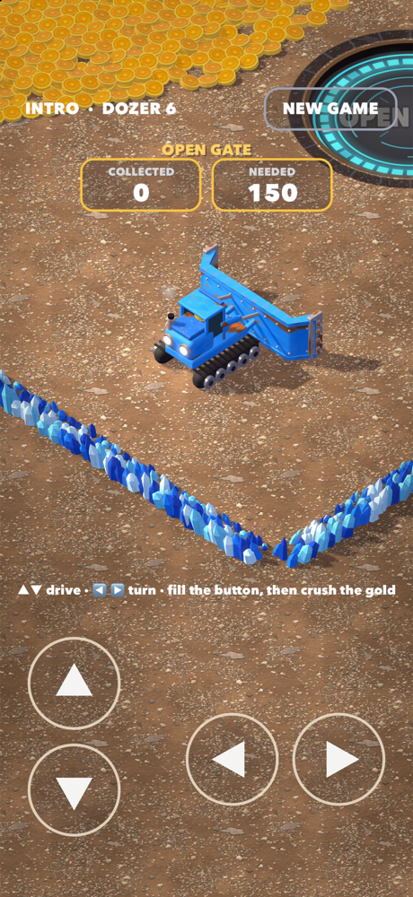

# Gold Grinder

An isometric 3D bulldozer game for iPhone and Mac, written in Swift with SceneKit (rendered on Metal).

Drive a little bulldozer with a zombie driver, scoop up the gold coins a conveyor belt throws into the mine, and push them into
heaps on glowing buttons in the floor. When a heap is big enough it melts into the button and you get a
bigger dozer or open the gate to the next mine. Melt a huge golden pile in the last mine to win.

Inspired by "Idle Zombie Miner" ads.



## How to play

### The intro

Every new game starts with a taste of power: the biggest dozer with a flat blade, in a huge blue crystal
vault with a mountain of gold coins on one side. Plough 400 coins across into the **OPEN GATE** button to open the
gate, then push 50 gold lumps in the next room onto the crusher's belt. Then it's on to the quarry, in dozer 1.

### The quarry (up top)

The game starts in a desert quarry above the mines: four red sandstone rooms laid out like the mines.

- Push the big **gold blocks** onto the **feeder belt** in the floor by the room's left wall. The belt carries them
  into the **crusher** set in the wall, which grinds them into coins that ride a conveyor out the back
  and down a shaft to the mines.
- Gold comes in four sizes. Bigger lumps are worth more gold (1 to 4) but need a bigger dozer to move:
  try a big one too early and it won't budge ("NEED DOZER 2!").
- The counters at the top show the gold you have put into the room's crusher and the gold its gate needs.
  Crush enough small lumps and you get a bigger dozer, which can move the big ones that finish the room.
- After the fourth room you head down to mine 1.
- Round 1 tops out at dozer 3 up here and dozer 4 in the mines. The biggest dozers (and the huge gold lumps)
  wait for round 2.

### The mines

- Each mine is fed by a **conveyor belt** outside its wall. Random little piles of coins ride out of a hopper,
  and at the end of the belt the coins fly through a gap in the crystal wall and scatter across the mine floor.
  The belt slows down as it empties and finally runs dry. It is the only gold in the mine.
- Push coins into a **button**, a glowing well sunk into the floor (orange: next dozer, purple: gate, yellow: victory).
  The ring around it fills up as coins pile on. Push coins off again and it goes down.
  The counters at the top show how many coins are on the nearest button and how many it needs.
- When the pile reaches the price, it **melts** into the button:
  - **DOZER** buttons give you the next, bigger bulldozer (6 levels, wider plows, more pushing power).
  - **GATE** buttons open the next mine (4 mines, each coin is worth more: 1, 3, 8, 25).
  - The yellow button in mine 4 needs 400 coins. In round 1 it says **NEXT ROUND** and takes you straight on
    to round 2; from round 2 it says **VICTORY** and shows the win screen before the next round starts back up
    in the quarry. Each round is harder: more gold blocks per quarry room, and the mine buttons need
    25% more coins per round (up to +50%), with fuller belts to match.
- Buttons need 100 coins each in mine 1, 200 in mine 2, 300 in mine 3 and 400 in mine 4.
- Each belt holds just a little more gold than its mine's dozer and gate cost together, so collect every coin.
- The game does not save. **NEW GAME** (top right, tap twice) starts over, back up in the quarry.

### Controls

| | Drive | Notes |
|---|---|---|
| iPhone | On-screen buttons: ▲ / ▼ on the left, ◀ / ▶ on the right | Use both thumbs at once. |
| Mac, mouse | Drag where you want to go | Drag behind the dozer to back up. |
| Mac, keyboard | W / S forward and reverse, A / D turn | Arrow keys work too. |

## Building

Requires Xcode (made with Xcode 27, iOS 17+ / macOS 14+).

### Mac

```sh
swift run -c release
```

Use the release build: the coin physics is too slow in a debug build.
If `swift` picks the Command Line Tools instead of Xcode, prefix the command with
`DEVELOPER_DIR=/Applications/Xcode.app/Contents/Developer`.

### iPhone

1. Open `iOS/GoldGrinder.xcodeproj` in Xcode.
2. Under *Signing & Capabilities*, pick your own team (and change the bundle ID if needed).
3. Choose your iPhone or a simulator and press Run.

The project compiles the shared game code with optimisation even in Debug, so it runs smoothly on device.

## Project layout

```
Package.swift                 Swift package for the Mac app
Sources/GoldGrinder/
  main.swift                  Mac window, mouse and keyboard input
  Game.swift                  Game rules, mines, belts, buttons, camera, driving
  Coins.swift                 Coin physics (pushing, stacking, falling) and batched coin rendering
  Quarry.swift                The desert quarry: gold blocks, crushers, and the trip down to the mines
  Intro.swift                 The intro: a coin vault and a gold room, with the biggest dozer
  DozerModel.swift            The six 3D bulldozers, built from code
  Art.swift                   Materials, crystal walls, textures, signs and icons (CoreGraphics)
  Hud.swift                   2D overlay: labels, joystick, NEW GAME button, win screen
  Resources/dozer1-6.png      Dozer pictures used on the button signs
iOS/
  GoldGrinder.xcodeproj       iPhone app project (uses the shared sources above)
  GoldGrinder/App.swift       iPhone app, scene and touch input
  GoldGrinder/Assets.xcassets App icon
docs/screenshot.png           Screenshot for this README
```

## How it works

- **Rendering:** SceneKit on Metal with an orthographic isometric camera, HDR bloom, shadows and
  physically based materials. The dozers, crystal walls, belts and buttons are all built from code.
- **Coins:** thousands of coins with simple 2D physics on the ground plane. Coins sleep until touched,
  climb on top of each other when squeezed (so heaps form), and fall when nothing is under them.
  They are drawn in 3x3 m chunks, and a chunk's mesh is only rebuilt when one of its coins moves.
- **Buttons** are placed in open floor away from the walls so you can push gold onto them from any side.
- **iPhone start-up:** the coins, molten blob and sparks are drawn once under the floor at launch, so the
  iPhone prepares their shaders while loading instead of stalling at the first melt.
- **The plow** is a polyline that is both drawn and used as the collision wall, so coins collect inside it
  and turn with the dozer. The whole dozer outline collides with walls, and it backs off a little when a turn
  would swing the plow into a wall.
